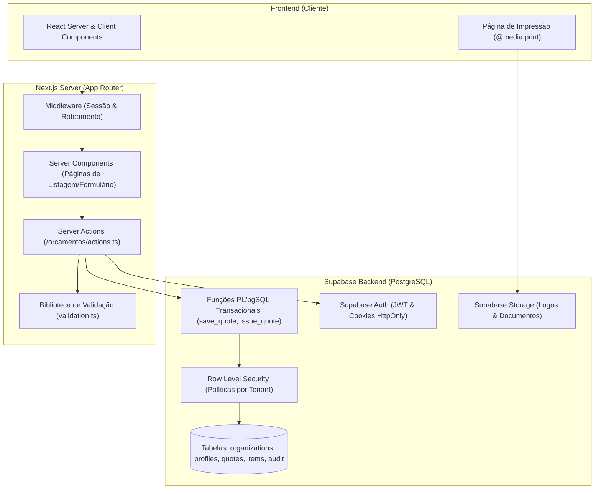

# 2. TRD — Technical Requirements Document
## Arquitetura e Especificações Técnicas do Sistema

**Projeto:** Gerador de Orçamentos  
**Versão do Documento:** 2.0  
**Data:** 11/11/2026  
**Status:** Consolidado com a Implementação Técnica  

---

## 1. Stack Tecnológica Fundamentada

| Camada | Tecnologia Adotada | Versão | Justificativa Técnica |
| :--- | :--- | :--- | :--- |
| **Runtime & Node** | Node.js | `>=22.13.0` (auditado: `v24.22.1`) | Suporte a recursos modernos de JavaScript, ESM nativo e execução estável em produção. |
| **Gerenciador de Pacotes** | npm | `>=11` (referência: `11.19.1`) | Padronizado via `package.json` com `package-lock.json` rigorosamente versionado. |
| **Framework Full-Stack** | Next.js | `16.4.6` (App Router) | Renderização híbrida (RSC), rotas dinâmicas, Server Actions nativas e excelente performance com Turbopack/Webpack. |
| **Biblioteca de UI** | React | `19.3.0` | Suporte a Server Components, Actions, transições de estado assíncronas e renderização concorrente. |
| **Linguagem** | TypeScript | `^5.0.0` | Tipagem estática em todo o projeto, geração de interfaces de banco de dados e prevenção de bugs em tempo de compilação. |
| **Estilização** | Tailwind CSS | `v4.3.3` | Abordagem utility-first de alta performance, suporte a CSS `@theme`, tokens CSS nativos e sem overhead de compilação legada. |
| **Ícones** | Lucide React | `^1.71.0` | Conjunto abrangente de ícones SVG limpos, tree-shakable e consistentes. |
| **Datas & Formatação** | date-fns | `^4.4.0` | Manipulação imutável e leve de datas, cálculo de validade e formatação em pt-BR. |
| **Backend & BaaS** | Supabase | `@supabase/ssr ^0.12.7`, `@supabase/supabase-js ^2.119.0` | Backend unificado: PostgreSQL relacional, Autenticação JWT via cookies seguros, Storage de arquivos e políticas RLS. |
| **Banco de Dados** | PostgreSQL | `15+` (Supabase Hosted) | Integridade referencial estrita, triggers transacionais, extensões `pgcrypto` e `uuid-ossp`, e suporte a PL/pgSQL. |

---

## 2. Arquitetura do Sistema

### 2.1 Padrão Arquitetural
A aplicação adota a arquitetura modular baseada em **Next.js App Router (React Server Components + Server Actions)** integrada com um backend relacional transacional no PostgreSQL.



### 2.2 Estrutura de Diretórios
```text
src/
├── app/
│   ├── (authenticated)/         # Rotas protegidas (layout com sidebar/header)
│   │   ├── admin/
│   │   │   ├── configuracoes/   # Gestão da Organização e Branding
│   │   │   └── vendedores/      # Gestão de Usuários da Equipe
│   │   ├── orcamentos/
│   │   │   ├── [id]/
│   │   │   │   ├── editar/      # Formulário de edição de rascunhos
│   │   │   │   ├── imprimir/    # Rota limpa de impressão / PDF timbrado
│   │   │   │   └── page.tsx     # Detalhes do orçamento
│   │   │   ├── novo/            # Criação de novo orçamento
│   │   │   ├── actions.ts       # Server Actions transacionais
│   │   │   └── page.tsx         # Listagem com filtros e métricas
│   │   ├── perfil/              # Perfil do vendedor (nome e telefone)
│   │   └── layout.tsx           # Shell autenticado comum
│   ├── auth/confirm/            # Callback de autenticação Supabase
│   ├── login/                   # Tela pública de login
│   ├── globals.css              # Configuração Tailwind v4 e utilitários de impressão
│   └── layout.tsx               # Root layout HTML
├── components/
│   ├── app-header.tsx           # Barra superior com usuário e ações rápidas
│   ├── app-sidebar.tsx          # Menu lateral responsivo
│   ├── currency-input.tsx       # Input com máscara financeira em centavos
│   ├── quote-form.tsx           # Formulário guiado com prévia em tempo real
│   ├── quote-printable-doc.tsx  # Documento com papel timbrado oficial
│   └── sign-out-button.tsx      # Ação de encerramento de sessão
├── lib/
│   ├── supabase/                # Clientes Supabase SSR (client, server, middleware)
│   ├── perf.ts                  # Utilitário de telemetria e logs de performance
│   ├── utils.ts                 # Formatadores de moeda, documento e CSS merge
│   └── validation.ts            # Validações puras de regras de formulário
└── types/
    ├── actions.ts               # Tipagens das entradas e saídas de Server Actions
    └── database.ts              # Modelos tipados espelhados do banco
```

---

## 3. Integrações e Serviços Externos

### 3.1 Supabase Auth
- **Autenticação:** Baseada em e-mail e senha com gerenciamento de sessão via cookies seguros `HttpOnly`, `SameSite=Lax`.
- **Sessão Server-Side:** Renovação automática através de `@supabase/ssr` executado no middleware do Next.js (`src/lib/supabase/middleware.ts`).
- **Prevenção de Inconsistências:** Usuários desativados (`active = false`) ou sem perfil provisionado são interceptados e deslogados imediatamente.

### 3.2 Supabase Storage
- **Buckets Privados:** Armazenamento seguro de logotipos da organização (`logo_storage_key`) e eventuais cópias de PDFs arquivados (`pdf_storage_key`).
- **Resolução de Imagens:** As URLs de logotipo são resolvidas com segurança para a montagem do cabeçalho timbrado.

### 3.3 Supabase Database (PostgreSQL)
- **Operações Transacionais via RPCs:** Criação de orçamentos, emissão com incremento sequencial e cancelamento ocorrem dentro de transações atômicas no PostgreSQL, garantindo que não existam estados parciais.
- **Isolamento de Conexão:** Comunicação segura com pooling de conexões via Transaction Pooler do Supabase.

---

## 4. Segurança e Conformidade

### 4.1 Controle de Acesso Baseado em Papéis (RBAC)
- **Papel `seller` (Vendedor):**
  - Cria novos orçamentos como rascunho (`draft`).
  - Edita apenas seus próprios orçamentos enquanto estiverem em rascunho.
  - Emite seus próprios orçamentos (`issued`).
  - Imprime e visualiza propostas emitidas.
  - Atualiza seu próprio telefone e nome na tela `/perfil`.
- **Papel `admin` (Administrador):**
  - Possui todos os privilégios do vendedor.
  - Acessa e edita dados da organização (marca, logotipo, prefixo, cores).
  - Cadastra, ativa, desativa e edita perfis de vendedores.
  - Visualiza orçamentos de todos os colaboradores e acessa métricas globais da empresa.
  - Pode cancelar orçamentos emitidos de qualquer vendedor mediante justificativa.

### 4.2 Bloqueio de Auto-Promoção e Segurança de Perfil
- A criação de perfis na tabela `profiles` é restrita a administradores ou triggers de provisionamento controlado. O papel (`role`) é protegido e nunca aceita promoção via metadados enviados pelo cliente no cadastro.
- Triggers de auditoria e validações de integridade bloqueiam qualquer tentativa de alterar `organization_id` de registros existentes.

### 4.3 Idempotência e Concorrência Otimista
- **`save_quote_draft`:** Recebe um `last_write_request_id` (UUID). Se a mesma requisição for re-enviada por falha de rede ou duplo clique, o banco detecta a chave idêntica e retorna o estado existente sem duplicar itens.
- **Controle de Versão:** A gravação exige `expected_version`. Se outro operador salvou o orçamento concorrentemente, o sistema rejeita a alteração informando que o documento foi modificado em outra sessão.

### 4.4 Tratamento de Segredos e Variáveis de Ambiente
- `NEXT_PUBLIC_SUPABASE_URL` e `NEXT_PUBLIC_SUPABASE_ANON_KEY`: públicas, restritas a operações protegidas por RLS.
- Chaves de serviço (`SUPABASE_SERVICE_ROLE_KEY`): estritamente de servidor, nunca expostas ao cliente e utilizadas apenas em rotas administrativas restritas (ex: convite e exclusão controlada de autenticação).

---

## 5. DevOps, Build e Monitoramento

### 5.1 Pipeline de Validação Local
O projeto conta com comandos unificados de verificação de qualidade sem dependências externas:
```powershell
# Execução completa da esteira de validação:
npm run check
```
A esteira executa sequencialmente:
1. `npm run typecheck` — Validação estrita do compilador TypeScript (`tsc --noEmit --incremental false`).
2. `npm run lint` — Análise estática com ESLint 9 e regras do Next.js.
3. `npm test` — Bateria de testes automatizados com o Node.js Test Runner nativo (`node --test "tests/**/*.test.mjs"`), testando cálculos, validações de formulário e regras de negócio sem necessidade de banco ativo.

### 5.2 Monitoramento de Performance
- A função utilitária `logPerf` em `src/lib/perf.ts` monitora a latência das operações críticas no servidor (Server Actions e RPCs).
- Métricas calculadas para a listagem possuem cache em memória (`metricsMemoryCache`) no servidor com TTL de 15 segundos, invalidado automaticamente após qualquer inserção, emissão ou cancelamento de orçamento.

