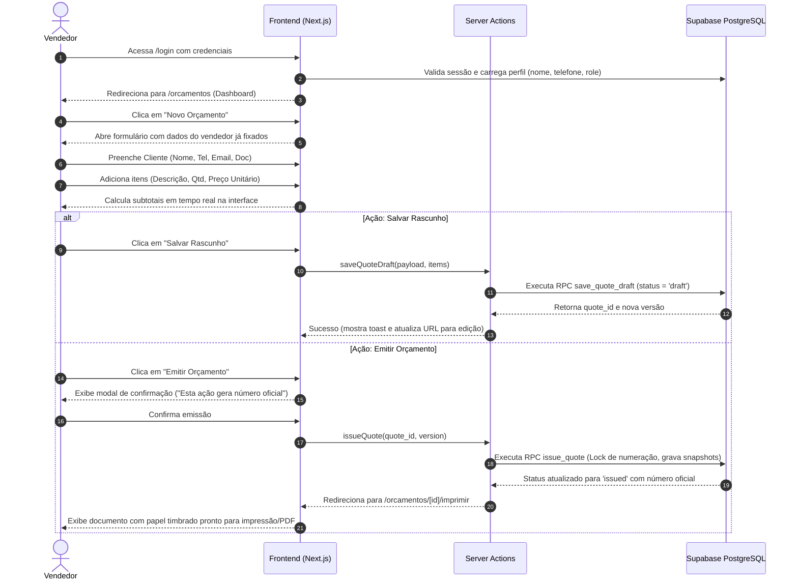
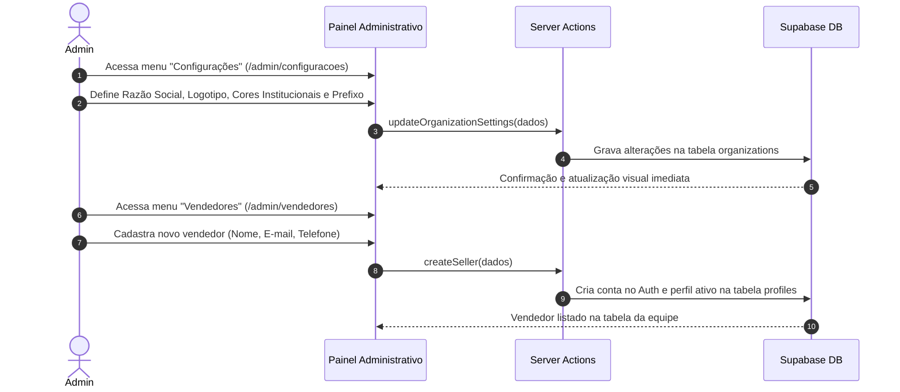

# 3. Fluxo do App — App Flow & User Journey
## Mapeamento de Navegação, Telas e Jornadas do Usuário

**Projeto:** Gerador de Orçamentos  
**Versão do Documento:** 2.0  
**Data:** 11/11/2026  
**Status:** Consolidado com a Aplicação  

---

## 1. Jornadas do Usuário (User Journeys)

### 1.1 Jornada Principal: Vendedor Criando e Emitindo um Orçamento



---

### 1.2 Jornada do Administrador: Gestão da Empresa e Equipe



---

## 2. Mapa de Rotas e Telas (Sitemap & Screen Map)

```text
┌── Rotas Públicas
│   ├── /login                 → Autenticação com e-mail e senha
│   └── /auth/confirm          → Validação de link mágico ou confirmação de token
│
└── Rotas Protegidas (Layout Autenticado com Sidebar e Header)
    │
    ├── /orcamentos            → Painel Principal
    │   ├── Métricas de topo (Emitidos, Rascunhos, Cancelados)
    │   ├── Barra de busca e filtros de status
    │   └── Tabela/Cartões de orçamentos com paginação
    │
    ├── /orcamentos/novo       → Tela de Criação
    │   ├── Identificação do Vendedor (somente leitura)
    │   ├── Dados do Cliente e Contato
    │   ├── Tabela Dinâmica de Itens e Subtotais
    │   ├── Condições de Pagamento, Validade e Observações
    │   └── Painel lateral de Pré-visualização ao vivo
    │
    ├── /orcamentos/[id]       → Visualização Detalhada
    │   ├── Resumo de dados da proposta
    │   ├── Badge de status e histórico de datas
    │   └── Ações contextuais (Editar se draft, Imprimir, Cancelar)
    │
    ├── /orcamentos/[id]/editar → Edição de Rascunho
    │   └── Restrito a propostas com status 'draft'
    │
    ├── /orcamentos/[id]/imprimir → Visualização Timbrada
    │   ├── Papel timbrado oficial sem elementos de navegação
    │   ├── Disparo do diálogo de impressão do navegador (PDF)
    │   └── Botão de voltar ao sistema
    │
    ├── /perfil                → Perfil do Usuário Logado
    │   └── Atualização de nome completo e telefone de contato
    │
    └── Área Administrativa (Restrita a role = 'admin')
        ├── /admin/configuracoes → Identidade visual, prefixo, validade e dados da empresa
        └── /admin/vendedores    → Listagem, cadastro, edição e ativação/desativação da equipe
```

---

## 3. Fluxograma de Estados do Orçamento (State Transition)

O ciclo de vida do orçamento é estritamente controlado pelo banco de dados:

```text
        ┌──────────────────────────────────────────────┐
        │                                              │
        ▼                                              │
┌──────────────┐         Ação: Emitir          ┌────────────────┐
│              │ ────────────────────────────> │                │
│  1. DRAFT    │                               │   2. ISSUED    │
│  (Rascunho)  │ <──────────────────────────── │   (Emitido)    │
│              │        (Não permitido;        │                │
└──────────────┘         imutabilidade)        └────────────────┘
       │                                                │
       │                                                │ Ação: Cancelar
       │ Exclusão física                                │ (Requer justificativa)
       │ permitida apenas                               ▼
       │ em rascunho                            ┌────────────────┐
       ▼                                        │  3. CANCELLED  │
   [ Excluído ]                                 │  (Cancelado)   │
                                                └────────────────┘
                                                        │
                                                        │ Validade ultrapassada
                                                        ▼ (Derivado na view)
                                                ┌────────────────┐
                                                │   4. EXPIRED   │
                                                │   (Expirado)   │
                                                └────────────────┘
```

### Regras de Transição:
1. **`draft` (Rascunho):**
   - Criação livre.
   - Itens, cliente e observações podem ser modificados repetidamente.
   - Não possui número sequencial oficial (`quote_number = null`).
2. **`issued` (Emitido):**
   - Recebe número oficial inalterável (ex: `ORC-0042`).
   - Grava `seller_name_snapshot` e `seller_phone_snapshot`.
   - **Edição desabilitada:** Os campos ficam permanentemente bloqueados.
   - **Exclusão bloqueada:** O orçamento não pode ser deletado do banco de dados.
3. **`cancelled` (Cancelado):**
   - Transição permitida apenas a partir de `issued`.
   - Exige preenchimento obrigatório do campo `cancel_reason`.
   - Registra o usuário cancelador (`cancelled_by`) e timestamp (`cancelled_at`).
4. **`expired` (Expirado):**
   - Calculado dinamicamente pela view `quote_list` quando `now() > valid_until` e o orçamento ainda está como `issued`.
   - O documento permanece consultável e imprimível com o aviso visual de validade expirada.

---

## 4. Tratamento de Casos de Borda e Erros

| Cenário de Borda | Comportamento da Interface / Sistema |
| :--- | :--- |
| **Vendedor sem telefone no cadastro** | A tela de novo orçamento exibe um alerta de aviso com link direto para `/perfil`, orientando o preenchimento antes da emissão formal. |
| **Concorrência ao salvar (duas abas abertas)** | A Server Action compara a `expected_version`. Se houver divergência, retorna erro: *"Este orçamento foi alterado em outra sessão. Recarregue a página."* |
| **Tentativa de editar orçamento já emitido** | A rota `/orcamentos/[id]/editar` valida o status. Se for diferente de `draft`, redireciona imediatamente para a tela de visualização com mensagem de bloqueio. |
| **Perda de conexão / Envio duplicado** | A requisição envia um UUID de idempotência (`last_write_request_id`). O banco de dados previne a duplicação dos itens na transação. |
| **Tentativa de exclusão de proposta emitida** | O banco de dados aciona a trigger de proteção e rejeita o `DELETE`, retornando erro de integridade de auditoria. |
| **Vendedor desativado pelo administrador** | O middleware e o cliente Supabase detectam `active = false` na primeira requisição e forçam o encerramento da sessão com redirecionamento para o login. |

