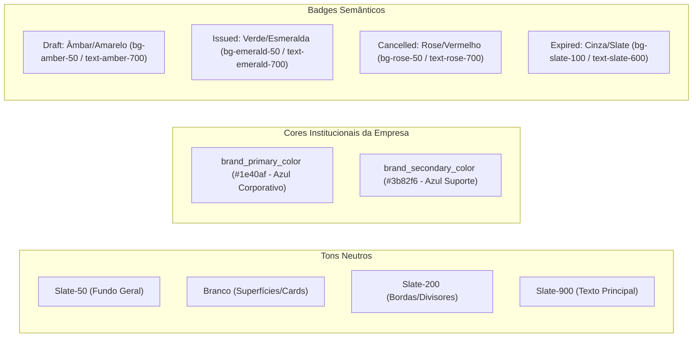

# 4. Briefing de Design — Design Brief & UI/UX Guidelines
## Identidade Visual, Design System e Diretrizes de Impressão

**Projeto:** Gerador de Orçamentos  
**Versão do Documento:** 2.0  
**Data:** 11/11/2026  
**Status:** Consolidado com a Aplicação  

---

## 1. Identidade Visual e Conceito

### 1.1 Estética Geral (Clean B2B SaaS)
A aplicação adota uma estética limpa, corporativa e funcional, priorizando:
- **Clareza e Legibilidade:** Interface desprovida de ruídos visuais, com espaçamento generoso e tipografia com contraste ideal.
- **Eficiência Operacional:** Formulários ergonômicos com preenchimento em lote, teclagem rápida de valores e cálculo automático sem necessidade de recarregar a tela.
- **Dualidade de Apresentação:**
  1. *Modo Aplicação (Web App):* Interface moderna com navegação lateral, cabeçalho e cards com cantos arredondados (`rounded-xl`), sombras suaves (`shadow-sm`) e estados interativos.
  2. *Modo Papel Timbrado (Documento A4 Oficial):* Layout formal para impressão física ou PDF, com rigor técnico, cabeçalho institucional e paginação limpa.

---

## 2. Paleta de Cores e Tokens Semânticos

A paleta de cores combina um núcleo neutro estável com cores institucionais customizáveis por organização:

### 2.1 Mapeamento de Tokens CSS

| Papel | Token / Variável | Uso na Aplicação |
| :--- | :--- | :--- |
| **Fundo da Aplicação** | `#f8fafc` (`slate-50`) | Canvas principal da tela de dashboard e formulários. |
| **Superfície de Cards** | `#ffffff` (`white`) | Painéis de conteúdo, formulários e modais. |
| **Bordas** | `#e2e8f0` (`slate-200`) | Contorno de tabelas, cartões e separadores de seção. |
| **Texto Primário** | `#0f172a` (`slate-900`) | Títulos, rótulos de campos e valores totais em destaque. |
| **Texto Secundário** | `#64748b` (`slate-500`) | Textos auxiliares, datas, legendas e descrições secundárias. |
| **Primária da Empresa** | `var(--brand-primary)` | Cor de destaque em botões principais, cabeçalho do documento timbrado e badges. |
| **Secundária da Empresa**| `var(--brand-secondary)`| Efeitos de foco, acentos visuais e links institucionais. |

---

## 3. Tipografia e Escalas

A tipografia utiliza a fonte padrão sans-serif de alta legibilidade (`Inter`, complementada pela stack nativa do sistema operacional):

| Estilo | Tamanho / Peso | Aplicação |
| :--- | :--- | :--- |
| **H1 (Título de Página)** | `24px` a `30px` / Semibold (`font-semibold`) | Título principal das telas ("Novo Orçamento", "Meus Orçamentos"). |
| **H2 (Seções do Formulário)**| `18px` a `20px` / Medium (`font-medium`) | Subtítulos de blocos ("Dados do Cliente", "Itens da Proposta"). |
| **H3 / Tabela Head** | `13px` a `14px` / Medium (`font-medium`) | Cabeçalhos de coluna na tabela de itens e listagens. |
| **Corpo / Inputs** | `14px` / Regular (`font-normal`) | Campos de texto, descrições e parágrafos informativos. |
| **Snapshot / Legendas** | `12px` / Regular (`text-xs text-slate-500`) | Telefone do vendedor, datas de emissão e observações legais. |
| **Valores Financeiros** | `16px` a `24px` / Bold (`font-bold tabular-nums`) | Total da proposta e subtotais, com alinhamento numérico tabular. |

---

## 4. Componentes Chave do Design System

### 4.1 Componente de Moeda (`CurrencyInput`)
- **Máscara Automática:** Converte digitação direta em formato monetário padrão brasileiro (`R$ 0,00`).
- **Precisão em Centavos:** A interface trabalha com digitação amigável, mas o estado interno e o envio à Server Action são sempre realizados em números inteiros de centavos (`bigint`/`number`).
- **Feedback Tabular:** Numerais alinhados à direita para leitura matemática natural.

### 4.2 Formulário de Orçamento (`QuoteForm`)
- **Estrutura em Colunas:** 
  - *Coluna Principal (65% largura em desktop):* Campos de cliente, itens dinâmicos e observações.
  - *Coluna Lateral (35% largura):* Painel fixo com resumo de valores, dados do vendedor logado e botões de ação ("Salvar Rascunho" e "Emitir").
- **Tabela Dinâmica de Itens:**
  - Botão "+ Adicionar Item" para inclusão instantânea.
  - Campos em linha: Descrição (flexível), Quantidade (com suporte a decimais), Preço Unitário e Total da Linha calculado na hora.
  - Botão de exclusão com ícone `Trash2` com confirmação visual.

### 4.3 Documento Timbrado (`QuotePrintableDoc`)
- **Cabeçalho:** Logotipo da empresa alinhado à esquerda, dados de identificação do orçamento à direita (número em destaque, data de emissão, validade).
- **Faixa do Vendedor:** Identificação explícita do vendedor responsável: *"Atendido por: [Nome do Vendedor] — Tel: [Telefone]"*.
- **Tabela de Itens Formal:** Linhas zebradas suaves com cabeçalho colorido pela cor primária da empresa.
- **Quadro de Totais:** Subtotal, descontos (quando houver) e Valor Total em destaque.
- **Rodapé:** Dados cadastrais da empresa (endereço, CNPJ, telefone, e-mail institucional).

---

## 5. Diretrizes de Impressão e PDF (@media print)

O layout de impressão no arquivo `src/app/(authenticated)/orcamentos/[id]/imprimir/page.tsx` segue regras técnicas rigorosas:

1. **Ocultação de Elementos Web (`no-print`):**
   - A barra lateral de navegação (`AppSidebar`), o cabeçalho superior (`AppHeader`), botões de voltar e comandos de ação são omitidos na impressão.
2. **Fidelidade de Cores e Fundos:**
   - A propriedade CSS `-webkit-print-color-adjust: exact; print-color-adjust: exact;` é aplicada para garantir que as cores do papel timbrado e cabeçalhos de tabela sejam impressos sem cortes pelo navegador.
3. **Controle de Paginação:**
   - Tabelas e blocos de assinatura utilizam `page-break-inside: avoid;` para evitar que uma linha de item ou o bloco de totais seja cortado ao meio entre duas folhas A4.
4. **Margens e Proporções:**
   - Margens de impressão padronizadas em `15mm` em todos os lados.
   - Formato padrão configurado para folha **A4 Retrato**.

