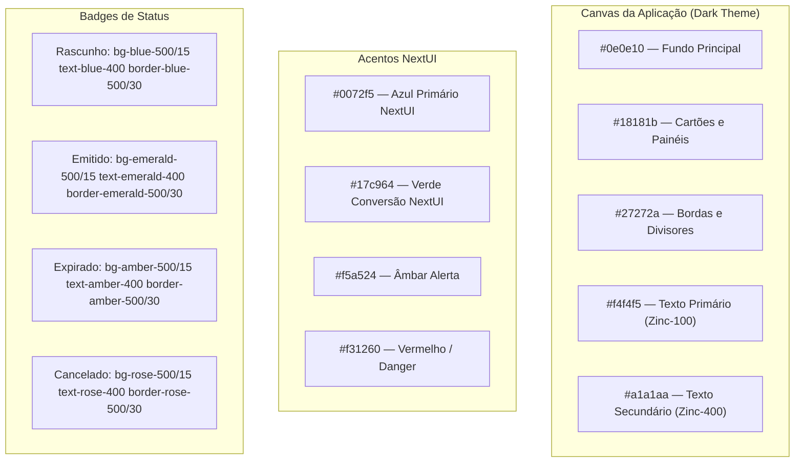

# 4. Briefing de Design — Design Brief & UI/UX Guidelines
## Identidade Visual, Design System NextUI Dark e Diretrizes de Impressão

**Projeto:** Gerador de Orçamentos  
**Versão do Documento:** 3.0  
**Data:** 12/11/2026  
**Status:** Atualizado com Tema NextUI Dashboard (Dark Mode Moderno & Apex Visuals)  

---

## 1. Identidade Visual e Conceito

### 1.1 Estética NextUI Dashboard (Sleek Dark B2B SaaS)
A aplicação adota a estética premium do **NextUI Dashboard** (HeroUI / Vercel Dark Style), caracterizada por:
- **Canvas Ultra Dark:** Fundo principal profundo (`#0e0e10`), superfícies de cards em cinza grafite (`#18181b`) e bordas sutis de alta precisão (`#27272a` / `zinc-800`).
- **Acentos Vibrantes com Luz e Profundidade:**
  - *NextUI Blue:* `#0072f5` (Pills ativas de navegação, cards de destaque e botões primários com glow `shadow-blue-500/20`).
  - *NextUI Emerald/Green:* `#17c964` (Cards de conversão, valores positivos de propostas e curvas de estatísticas).
  - *NextUI Warning:* `#f5a524` (Orçamentos expirando e alertas).
  - *NextUI Danger:* `#f31260` (Cancelamentos e ações destrutivas).
- **Dualidade de Apresentação:**
  1. *Modo Aplicação (Web App):* Experiência visual escura imersiva, cards KPI coloridos (azul sólido, grafite e verde sólido), gráficos de área com curvas suaves luminosas e navegação lateral refinada.
  2. *Modo Papel Timbrado (Documento A4 Oficial):* Layout 100% formal para impressão física e exportação PDF em fundo branco puro (`#ffffff`), preservando o layout contínuo A4 e a identidade visual timbrada da empresa.

---

## 2. Paleta de Cores e Tokens Semânticos

### 2.1 Mapeamento de Tokens CSS

| Papel | Token / Valor | Aplicação na Interface |
| :--- | :--- | :--- |
| **Fundo Global (App)** | `#0e0e10` | Canvas base da aplicação autenticada e login. |
| **Superfície dos Cards** | `#18181b` | Cards do dashboard, modais, tabelas e formulários. |
| **Bordas Sutis** | `#27272a` | Divisores, contorno de inputs e bordas de cards. |
| **Texto Primário** | `#f4f4f5` (`zinc-100`) | Títulos, numerais tabulares e rótulos de campos. |
| **Texto Muted** | `#a1a1aa` (`zinc-400`) | Legendas, datas, subtítulos e placeholders. |
| **Destaque Azul NextUI**| `#0072f5` | Pill de navegação ativa, card KPI 1 e CTA principal. |
| **Destaque Verde NextUI**| `#17c964` | Card KPI 3, valores monetários positivos e linha 1 do gráfico. |

---

## 3. Componentes Estruturais do Dashboard

### 3.1 Sidebar NextUI
- **Identidade da Organização:** Card superior com ícone em relevo, nome da empresa e nível de permissão (Administrador / Vendedor).
- **Links com Pills:** Destaque ativo em pílula azul `#0072f5` com cantos arredondados (`rounded-xl`) e sombra colorida.
- **Categorização:** Seções delimitadas ("Menu Principal", "Administração", "Sistema").
- **Rodapé de Usuário:** Avatar com anel de status, telefone/e-mail e botão de logout instantâneo.

### 3.2 Top Header (Navbar)
- **Barra de Pesquisa:** Input arredondado tipo pill (`rounded-full bg-[#18181b] border-zinc-800`).
- **Ações Rápidas:** Botão "+ Novo Orçamento", sineta de notificações com badge de status e avatar do vendedor logado com anel gradiente.

### 3.3 Cards de Indicadores (KPIs)
- **Card 1 (Azul Sólido - `#0072f5`):** Total emitido acumulado, percentual de crescimento e contagem de orçamentos.
- **Card 2 (Grafite Escuro - `#18181b`):** Orçamentos em aberto / rascunhos em negociação.
- **Card 3 (Verde Sólido - `#17c964`):** Ticket médio e taxa de conversão.

### 3.4 Área Gráfica (Statistics)
- Gráfico interativo com duas curvas de área suaves (Cyan/Azul `#0072f5` e Esmeralda `#17c964`) com preenchimento em gradiente translúcido, linhas de grade horizontais escuras e tooltips com design glassmorphic.

### 3.5 Coluna Lateral Direita
- **Card Equipe / Vendedores:** Avatar stack com anéis de destaque e métricas de desempenho.
- **Card Últimas Propostas:** Listagem recente com cliente, vendedor, valor formatado em verde vibrante e data.

---

## 4. Diretrizes de Impressão & A4

> [!IMPORTANT]
> O tema Dark é exclusivo da interface operacional da plataforma web. Toda e qualquer visualização ou impressão do documento timbrado (`/orcamentos/[id]/imprimir` e `@media print`) deve manter fundo branco absoluto (`#ffffff`), fontes escuras de alto contraste e layout rigorosamente calibrado para folha A4 contínua.
