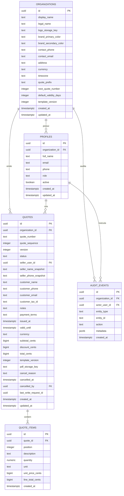

# 5. Esquema do Back-end — Backend Architecture & Data Schema
## Modelagem de Dados, Regras de Negócio e Especificação de APIs

**Projeto:** Gerador de Orçamentos  
**Versão do Documento:** 2.0  
**Data:** 11/11/2026  
**Status:** Consolidado com o Schema e Migrations do PostgreSQL  

---

## 1. Modelagem Entidade-Relacionamento (ER Diagram)



---

## 2. Dicionário de Dados e Tabelas

### 2.1 Tabela `public.organizations`
Armazena a entidade jurídica/empresa (tenant).
- `id` (uuid, PK): Identificador único da empresa.
- `display_name` (text, not null): Nome fantasia da empresa.
- `legal_name` (text): Razão social formal (opcional).
- `logo_storage_key` (text): Chave do arquivo de logotipo no Supabase Storage.
- `brand_primary_color` (text, default `#1e40af`): Cor primária institucional em formato HEX.
- `brand_secondary_color` (text, default `#3b82f6`): Cor secundária de destaque.
- `contact_phone`, `contact_email`, `address` (text): Dados de contato institucional exibidos no rodapé do documento.
- `quote_prefix` (text, default `'ORC'`): Prefixo da numeração (ex: `ORC-0001`).
- `next_quote_number` (integer, default 1): Ponteiro atômico da próxima numeração oficial.
- `default_validity_days` (integer, default 15): Prazo padrão em dias para validade da proposta.

### 2.2 Tabela `public.profiles`
Armazena o perfil de cada colaborador, vinculado diretamente ao usuário do Supabase Auth (`auth.users.id`).
- `id` (uuid, PK): Chave primária referenciando `auth.users(id) ON DELETE CASCADE`.
- `organization_id` (uuid, FK): Vínculo com a organização (`ON DELETE RESTRICT`).
- `full_name` (text, not null): Nome completo do usuário.
- `email` (text, not null): E-mail de login.
- `phone` (text): Telefone de contato profissional para exibição automática no orçamento.
- `role` (text, not null, check: `admin` | `seller`): Papel de autorização do usuário.
- `active` (boolean, default true): Flag que determina se o usuário pode acessar a aplicação.

### 2.3 Tabela `public.quotes`
Armazena o cabeçalho, condições e dados financeiros de cada proposta.
- `id` (uuid, PK): Identificador único do orçamento.
- `organization_id` (uuid, FK): Tenant proprietário da proposta.
- `quote_number` (text): Código visual oficial (ex: `ORC-0001`), atribuído exclusivamente na emissão (`issued`).
- `quote_sequence` (integer): Número inteiro sequencial da organização.
- `version` (integer, default 1): Número de versão para controle de concorrência otimista.
- `status` (text, check: `draft`, `issued`, `cancelled`, `expired`): Estado do ciclo de vida.
- `seller_user_id` (uuid, FK): Perfil do vendedor autor da proposta.
- `seller_name_snapshot` (text): Snapshot do nome do vendedor no momento exato da emissão.
- `seller_phone_snapshot` (text): Snapshot do telefone do vendedor no momento exato da emissão.
- `customer_name` (text, not null): Nome do cliente destinatário.
- `customer_phone`, `customer_email`, `customer_tax_id` (text): Dados cadastrais do cliente.
- `notes` (text): Observações e especificações complementares.
- `payment_terms` (text): Condições de pagamento acordadas.
- `issued_at` (timestamptz): Timestamp da emissão oficial.
- `valid_until` (timestamptz): Timestamp de vencimento da validade da proposta.
- `subtotal_cents`, `discount_cents`, `total_cents` (bigint): Valores monetários armazenados em centavos.
- `cancel_reason` (text): Justificativa obrigatória preenchida no cancelamento.
- `cancelled_at` (timestamptz): Data do cancelamento.
- `cancelled_by` (uuid, FK): Usuário que realizou o cancelamento.
- `last_write_request_id` (uuid): Chave de idempotência para repetição segura de requisições.

### 2.4 Tabela `public.quote_items`
Armazena os produtos e serviços listados na proposta.
- `id` (uuid, PK): Identificador do item.
- `quote_id` (uuid, FK): Orçamento ao qual o item pertence (`ON DELETE CASCADE`).
- `position` (integer, not null): Ordem de exibição do item na tabela.
- `description` (text, not null): Descrição detalhada do produto ou serviço.
- `quantity` (numeric(12, 3), not null, default 1.0): Quantidade com suporte a decimais.
- `unit` (text): Unidade de medida opcional (ex: `un`, `m²`, `hrs`).
- `unit_price_cents` (bigint, not null): Valor unitário em centavos.
- `line_total_cents` (bigint, not null): Total da linha (`quantity * unit_price_cents`), recalculado no banco.

### 2.5 Tabela `public.audit_events`
Armazena trilhas de auditoria para operações críticas.
- `id` (uuid, PK): Identificador do evento.
- `organization_id` (uuid, FK): Organização associada.
- `actor_user_id` (uuid, FK): Usuário que disparou a ação.
- `entity_type` (text): Tipo da entidade auditada (`quote`, `profile`, `organization`).
- `entity_id` (text): ID do registro modificado.
- `action` (text): Verbo da ação (`created`, `issued`, `cancelled`, `updated`).
- `metadata` (jsonb): Detalhes adicionais da operação.

---

## 3. View Pública: `quote_list`

Para evitar recálculos frequentes e inconsistências de status na listagem, a view `public.quote_list` deriva o status `expired` em tempo real:

```sql
create or replace view public.quote_list as
select
    q.id,
    q.organization_id,
    q.quote_number,
    q.quote_sequence,
    q.version,
    case
        when q.status = 'issued' and q.valid_until is not null and q.valid_until < now() then 'expired'
        else q.status
    end as status,
    q.status as stored_status,
    q.seller_user_id,
    p.full_name as seller_name,
    q.customer_name,
    q.customer_phone,
    q.customer_email,
    q.customer_tax_id,
    q.notes,
    q.payment_terms,
    q.issued_at,
    q.valid_until,
    q.currency,
    q.subtotal_cents,
    q.discount_cents,
    q.total_cents,
    q.created_at,
    q.updated_at
from public.quotes q
left join public.profiles p on p.id = q.seller_user_id;
```

---

## 4. Catálogo de RPCs Transacionais (Stored Procedures)

### 4.1 `save_quote_draft`
Salva ou cria um orçamento em rascunho de forma atômica e idempotente:
- **Parâmetros:**
  - `p_quote_id` (uuid, opcional para novo)
  - `p_payload` (jsonb com dados do cliente e condições)
  - `p_items` (jsonb array com a lista de itens)
  - `p_expected_version` (integer, para validação de concorrência)
  - `p_request_id` (uuid, token de idempotência)
- **Comportamento:**
  - Valida se o usuário está ativo e pertence à organização.
  - Verifica se o orçamento já foi emitido (bloqueia alteração se `status != 'draft'`).
  - Atualiza o cabeçalho e recalcula os totais com base na soma dos itens.
  - Substitui as linhas em `quote_items` garantindo ordenação por `position`.
  - Incrementa o campo `version` e retorna o ID e nova versão.

### 4.2 `issue_quote`
Emite o orçamento oficialmente:
- **Parâmetros:**
  - `p_quote_id` (uuid)
  - `p_expected_version` (integer)
- **Comportamento:**
  - Obtém lock exclusivo na organização (`SELECT FOR UPDATE FROM organizations`).
  - Obtém o `next_quote_number` e gera o `quote_number` oficial formatado (ex: `ORC-0001`).
  - Incrementa o contador `next_quote_number` na tabela `organizations`.
  - Grava os snapshots `seller_name_snapshot` e `seller_phone_snapshot` extraídos do perfil ativo.
  - Atualiza o status para `issued`, data de emissão para `now()` e calcula a validade com base no prazo da organização.
  - Registra o evento de emissão na tabela `audit_events`.

### 4.3 `cancel_quote`
Cancela um orçamento emitido:
- **Parâmetros:**
  - `p_quote_id` (uuid)
  - `p_reason` (text, obrigatório)
- **Comportamento:**
  - Valida se o orçamento está no status `issued`.
  - Registra a justificativa em `cancel_reason`, autor em `cancelled_by` e timestamp em `cancelled_at`.
  - Atualiza o status para `cancelled`.
  - Registra o evento em `audit_events`.

### 4.4 `quote_metrics`
Calcula as métricas financeiras globais da organização:
- Executa agregação agregada no banco (`SUM`, `COUNT`) filtrando por `organization_id` e permissão de usuário, retornando totais emitidos, contagem de rascunhos e valores agregados sem necessidade de transferir milhares de linhas ao cliente.

---

## 5. Políticas de Segurança (Row Level Security - RLS)

Todas as tabelas possuem `ALTER TABLE ... ENABLE ROW LEVEL SECURITY`.

### 5.1 Funções Auxiliares de Segurança (`SECURITY DEFINER`)
- `current_user_organization_id()`: Retorna o UUID da organização do usuário autenticado a partir de `auth.uid()`.
- `current_user_is_admin()`: Retorna `true` se o usuário possui perfil ativo com `role = 'admin'`.
- `current_user_is_active()`: Retorna `true` se o perfil do usuário está ativo (`active = true`).

### 5.2 Regras de Políticas por Tabela
- **`organizations`:**
  - `SELECT`: Permitido para qualquer usuário autenticado e ativo pertencente à organização.
  - `UPDATE`: Permitido exclusivamente para usuários com papel `admin`.
- **`profiles`:**
  - `SELECT`: Usuários da mesma organização podem visualizar dados de contato de seus colegas.
  - `UPDATE`: Vendedores podem editar apenas seu próprio perfil (`id = auth.uid()`), exceto a coluna `role` e `organization_id`. Admins podem atualizar perfis da equipe.
  - `INSERT`: Restrito a admins ou rotas de provisionamento.
- **`quotes`:**
  - `SELECT`: Vendedores acessam seus próprios orçamentos; administradores acessam todos os orçamentos da organização.
  - `INSERT` / `UPDATE`: Vendedores inserem e atualizam rascunhos próprios. Alterações após emissão são bloqueadas no banco por constraint e trigger.
  - `DELETE`: Bloqueado para orçamentos emitidos (`issued`/`cancelled`). Apenas rascunhos podem ser removidos pelo autor.

