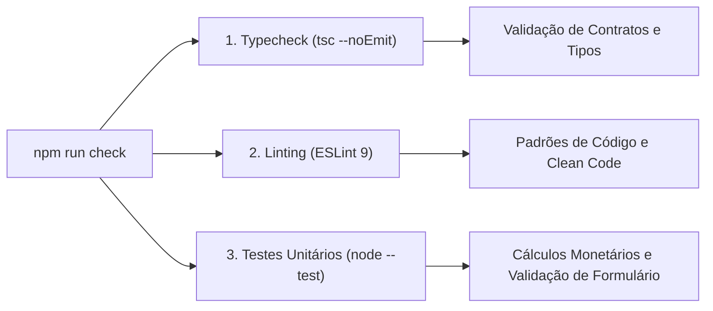

# 6. Plano de Implementação — Implementation & Execution Plan
## Fases, Checklist de Entregas, Testes e Procedimentos Operacionais

**Projeto:** Gerador de Orçamentos  
**Versão do Documento:** 2.0  
**Data:** 11/11/2026  
**Status:** Consolidado e Alinhado com o Estado Atual do Repositório  

---

## 1. Visão Geral das Fases e Status do Projeto

O projeto encontra-se em estágio avançado de maturidade técnica, com o núcleo da aplicação (frontend, backend e Server Actions) já desenvolvido e estruturado. A matriz abaixo detalha o status atual e o roteiro de evolução:

| Fase | Escopo Principal | Status Atual |
| :--- | :--- | :--- |
| **Fase 1: Infraestrutura & Autenticação** | Configuração do Next.js, Supabase Auth, middleware de sessão e rotas base. | **100% Concluída** |
| **Fase 2: Motor de Orçamentos & Server Actions** | Formulário dinâmico, máscara financeira, Server Actions transacionais e RPCs. | **100% Concluída** |
| **Fase 3: UI/UX, Papel Timbrado & Impressão** | Design system com Tailwind v4, layout de impressão A4 com `@media print` e prévia ao vivo. | **100% Concluída** |
| **Fase 4: Administração & Configurações** | Gestão de equipe de vendedores, perfil próprio e configurações da organização. | **100% Concluída** |
| **Fase 5: Endurecimento de Segurança & Testes** | RLS estrito, snapshots de vendedor, concorrência otimista e suíte de testes locais. | **Implementado no Código** *(Pendente de Homologação no Banco Ativo)* |
| **Fase 6: Próximas Evoluções (Roadmap)** | Geração de PDF no Storage, envio direto via WhatsApp, duplicação de propostas e relatórios. | **Planejamento Futuro** |

---

## 2. Checklist Detalhado por Fase

### Fase 1: Fundação, Infraestrutura e Autenticação [CONCLUÍDA]
- [x] Inicialização do projeto Next.js 16 (App Router) com TypeScript e Tailwind CSS v4.
- [x] Configuração dos clientes `@supabase/ssr` para client, server e middleware.
- [x] Implementação da tela de login (`/login`) com autenticação individual via Supabase.
- [x] Middleware de proteção de rotas com interceptação de usuários inativos ou sem sessão.
- [x] Estruturação da tabela `organizations` e `profiles` vinculadas ao `auth.users`.

### Fase 2: Core Features — Emissão e Gestão de Orçamentos [CONCLUÍDA]
- [x] Criação da tela de listagem de orçamentos (`/orcamentos`) com filtros de status e busca.
- [x] Implementação de cartões de métricas globais da organização (Emitidos, Rascunhos, Cancelados).
- [x] Criação do componente `CurrencyInput` com máscara monetária em centavos (BRL).
- [x] Desenvolvimento do formulário `QuoteForm` com adição/remoção dinâmica de itens e cálculo em tempo real.
- [x] Implementação da Server Action `saveQuoteDraft` com suporte a chave de idempotência (`last_write_request_id`).
- [x] Implementação da Server Action `issueQuote` com lock atômico de numeração sequencial.
- [x] Implementação de cancelamento com justificativa obrigatória (`cancelQuote`).

### Fase 3: Identidade Visual e Papel Timbrado [CONCLUÍDA]
- [x] Criação do componente `QuotePrintableDoc` para montagem do papel timbrado oficial.
- [x] Rota dedicada `/orcamentos/[id]/imprimir` com estilos CSS `@media print`.
- [x] Configuração de regras de quebra de página (`page-break-inside: avoid`) para evitar cortes no documento.
- [x] Suporte à exibição dinâmica do logotipo da empresa e dados institucionais no cabeçalho e rodapé.
- [x] Exibição explícita do vendedor responsável no documento emitido através dos dados snapshotados.

### Fase 4: Gestão Administrativa e Perfil [CONCLUÍDA]
- [x] Tela de edição de perfil do vendedor (`/perfil`) para atualização de nome e telefone.
- [x] Tela administrativa `/admin/configuracoes` para customização de cores, logotipo e prefixo da empresa.
- [x] Tela administrativa `/admin/vendedores` para cadastro, ativação/desativação e edição da equipe.
- [x] Controle de visibilidade de menus na barra lateral de acordo com o papel (`role = 'admin'`).

### Fase 5: Endurecimento de Segurança e Estabilidade [EM HOMOLOGAÇÃO]
- [x] Scripts de migração de segurança preparados em `supabase/migrations/`:
  - `20261111153000_security_and_integrity_hardening.sql`: Triggers de integridade, locking de emissão e RLS.
  - `20261111160000_performance_indexes.sql`: Índices para acelerar consultas e buscas.
  - `20261111170000_seller_profile_and_no_quote_delete.sql`: Bloqueio de exclusão de propostas emitidas.
- [x] Criação da suíte de testes automatizados com Node.js Test Runner em `tests/`.
- [ ] Homologação e execução das migrations finais em ambiente de banco de dados controlado.
- [ ] Validação prática de bloqueio de concorrência com acessos simultâneos.

### Fase 6: Próximas Evoluções (Roadmap Estratégico) [PLANEJADO]
- [ ] **Geração de PDF no Servidor:** Integração com worker headless (Puppeteer ou serviço serverless) para gerar e arquivar o PDF em bucket privado do Supabase Storage.
- [ ] **Compartilhamento por WhatsApp:** Botão com disparo de link curto ou mensagem formatada via API do WhatsApp.
- [ ] **Duplicação de Proposta:** Ação "Duplicar como novo rascunho" para agilizar a criação de orçamentos recorrentes.
- [ ] **Exportação de Relatórios:** Exportação do histórico de propostas em formato CSV/Excel para a gerência comercial.

---

## 3. Estratégia de Testes e Validação Contínua

A garantia de qualidade do projeto baseia-se em uma esteira ágil e leve que não depende de infraestrutura externa para validações rotineiras:



### 3.1 Comandos de Execução
```powershell
# Execução da esteira completa de validação
npm run check

# Execução individual dos testes de lógica em memória
npm test
```

### 3.2 Cobertura dos Testes Automatizados
- **Testes de Validação (`validation.test.mjs`):** Testam regras de obrigatoriedade de cliente, telefone, e-mail, quantidades decimais e limites de caracteres.
- **Testes de Cálculo Financeiro (`pricing.test.mjs`):** Validam a integridade matemática da multiplicação de quantidades fracionadas por centavos, arredondamentos e somas de subtotais e totais.
- **Testes de Formatação e Máscara:** Garantem que strings monetárias sejam convertidas confiavelmente em inteiros de centavos sem desvio.

---

## 4. Procedimentos Operacionais de Homologação e Deploy

> [!IMPORTANT]
> **Diretriz de Segurança Operacional:** Nenhuma migration deve ser aplicada em ambiente de produção sem backup prévio e teste em banco de dados descartável (staging).

### 4.1 Roteiro para Aplicação de Migrations no Banco Ativo
1. **Backup Completo:** Realizar dump dos dados existentes via painel do Supabase ou CLI (`supabase db dump`).
2. **Revisão das Migrations:** Validar a ordem cronológica em `supabase/migrations/`:
   - `20261111153000_security_and_integrity_hardening.sql`
   - `20261111160000_performance_indexes.sql`
   - `20261111170000_seller_profile_and_no_quote_delete.sql`
3. **Execução Transacional:** Rodar as migrations dentro de bloco `BEGIN ... COMMIT` para garantir que qualquer inconsistência reverta o estado anterior.
4. **Validação Funcional Pós-Migration:**
   - Criar um rascunho de teste com múltiplos itens.
   - Emitir o orçamento e verificar a geração do número sequencial.
   - Confirmar o preenchimento de `seller_name_snapshot` e `seller_phone_snapshot`.
   - Tentar excluir o orçamento emitido para comprovar que o bloqueio de segurança está ativo.
   - Cancelar o orçamento emitido informando motivo e validar a alteração de status.

---

## 5. Critérios de Aceite para Go-Live

Para liberação final e publicação do sistema, os seguintes critérios devem estar satisfeitos:

1. **Compilação e Testes:** `npm run check` executando com zero erros e zero avisos.
2. **Isolamento de Tenant:** Vendedor da Organização A não consegue visualizar orçamentos ou dados da Organização B.
3. **Snapshots Fixados:** Alteração posterior do telefone do vendedor no perfil não afeta o cabeçalho timbrado de orçamentos previamente emitidos.
4. **Precisão de Impressão:** Ao acionar `/orcamentos/[id]/imprimir` e abrir a janela de impressão do sistema, o documento A4 renderiza com cabeçalho completo, cores preservadas e sem botões ou menus visíveis.

